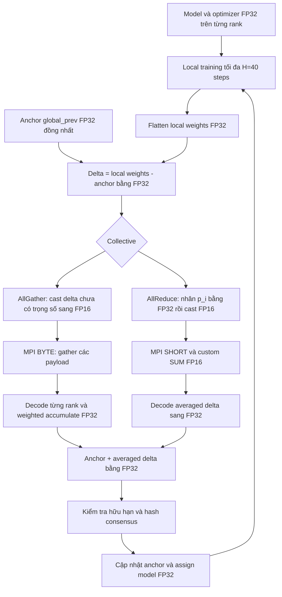

# FP16 Quantization trong Local SGD: bài toán, code hiện tại và cách đọc experiment

**Mốc tài liệu:** 12/10/2026. **Implementation đang được giải thích:** commit `1ddd9b0`, cộng tài liệu này.

Tài liệu này mô tả những gì đã có trong repository, những kiểm tra đã chạy và những kết luận chưa có dữ liệu để đưa ra. Các số liệu smoke lấy từ [summary đã lưu](../validation/delta_20261012/summary.json). Ví dụ số học trong tài liệu được phân biệt với số liệu training.

Mục tiêu hiện tại là kiểm tra xem **truyền phần thay đổi của model bằng FP16** có giữ thông tin cập nhật tốt hơn **truyền toàn bộ model bằng FP16** hay không, và đánh giá đổi lại về thời gian, bộ nhớ, accuracy. Training và optimizer vẫn dùng FP32. Thay đổi nằm ở tensor đưa vào MPI lúc synchronization.

Có hai trục so sánh:

| Trục | Những lựa chọn đang có | Điều muốn tìm hiểu |
|---|---|---|
| Nội dung payload | Whole-Weight hoặc Delta | Quantize toàn bộ weights hay quantize phần thay đổi? |
| Collective | AllGather hoặc AllReduce | Decode rồi accumulate FP32 hay reduce trực tiếp FP16? |

Thêm FP32 Local SGD làm reference baseline, tổng cộng **5 phương pháp**. Đã kiểm chứng transport và smoke delta trên 5 node thật. Chưa có bảng accuracy/performance của sweep 40 epochs; không có kết luận rằng delta đã tốt hơn baseline trong experiment dài.

## 1. Câu chuyện bắt đầu từ cluster không đồng nhất

Cluster hiện có 5 MPI ranks. Rank 0 trên lab01 dùng 2 GPU qua TensorFlow MirroredStrategy. Các ranks 1–4 trên lab02–lab05 chạy CPU. Batch được phân theo cấu hình:

```text
rank:                 0    1   2   3    4
node:               lab01 lab02 lab03 lab04 lab05
local batch size:    266    6   6   6   16
global batch size:   266 + 6 + 6 + 6 + 16 = 300
```

Trong Local SGD, mỗi rank giữ một model local và một optimizer local. Rank đó làm forward, backward và optimizer update bằng dữ liệu của mình. Sau một cửa sổ local steps, các ranks đồng bộ model để có một model global chung rồi tiếp tục cửa sổ kế tiếp.

Ở đây `H=40`: mỗi rank làm tối đa 40 local training steps giữa hai lần averaging model. H đo **số steps**, không đo số samples. Rank 0 dùng nhiều samples trong cùng 40 steps hơn các CPU ranks.

Số samples giữa hai sync đầy đủ H=40:

```text
n = [266 × 40, 6 × 40, 6 × 40, 6 × 40, 16 × 40]
  = [10640, 240, 240, 240, 640]
N = 12000
```

Local SGD ở đây không thực hiện MPI gradient AllReduce giữa 5 ranks sau từng optimizer step. Tuy nhiên, TensorFlow MirroredStrategy bên trong rank 0 vẫn có cơ chế làm việc giữa 2 GPU. Phần đó được giữ nguyên; FP16 communication trong tài liệu này nói về synchronization **giữa MPI ranks**.

## 2. Các ký hiệu sẽ dùng

| Ký hiệu | Nghĩa cụ thể |
|---|---|
| `i` | MPI rank |
| `t` | Một synchronization round |
| `W_i` | Toàn bộ weights local của rank i tại thời điểm sync |
| `B_t` | Model global từ lần sync trước; trong code tên là `global_prev` |
| `Δ_i` | `W_i - B_t`, phần thay đổi local so với anchor chung |
| `n_i` | Samples rank i đã xử lý từ lần sync gần nhất |
| `p_i` | `n_i / sum(n_j)` khi sample-weighted |
| `Q16(x)` | Cast tensor FP32 sang FP16 bằng NumPy |
| `D32(q)` | Cast tensor FP16 trở lại FP32 |
| `hat(Δ_i)` | Delta recover từ payload đã quantize |
| `D` | Số phần tử của buffer weights sau flatten |

`B_t` là anchor: một bản sao model FP32 dùng làm mốc chung. Nó có thể chứa sai số từ các sync trước. Nó không phải một model lý tưởng chưa từng chịu quantization.

## 3. Baseline FP32 đang làm gì?

Baseline `comm_precision: fp32` dùng sample-weighted averaging:

\[
W_{new}^{FP32} = \frac{\sum_i n_i W_i}{\sum_i n_i}.
\]

Luồng chính nằm trong `MPITrainer.synchronize_model_weights()`:

```python
local_weights = model.get_weights()
flat_w = concatenate_and_cast_to_fp32(local_weights)
weighted = flat_w * local_sample_count
summed = MPI_Allreduce_SUM_FP32(weighted)
total_samples = MPI_allreduce_SUM(local_sample_count)
global_flat_w = summed / total_samples
model.set_weights(unflatten(global_flat_w))
```

Code thực tế có fallback khi tổng samples bằng 0: AllReduce weights chưa nhân samples rồi chia world size. Với policy `uniform`, code average đều các ranks.

Ở baseline này:

- Model và optimizer vẫn theo training FP32 hiện có.
- Buffer weights đưa vào MPI là FP32.
- Phép cộng model buffer dùng MPI SUM trên FP32.
- Không có cast weights/delta sang FP16 trong nhánh này.

FP32 ở đây là baseline số học thực tế của chương trình, không phải số thực chính xác vô hạn. Phép cộng floating-point vẫn có rounding và phụ thuộc thứ tự reduction.

## 4. Tại sao thử giảm precision của communication?

Model ViT smoke có **2.693.578 phần tử** trong buffer weights:

| Buffer | Bytes/phần tử | Bytes/rank/sync | MiB/rank/sync |
|---|---:|---:|---:|
| FP32 | 4 | 10.774.312 | khoảng 10,275 |
| FP16 | 2 | 5.387.156 | khoảng 5,138 |

MiB ở đây bằng `1024 × 1024` bytes. Giá trị `payload_bytes` trong telemetry là kích thước **một model/delta buffer của một rank**, chưa cộng metadata, reference checking hoặc validation traffic.

Chuyển FP32 sang FP16 giảm một nửa kích thước buffer gửi. Nó không tự động giảm một nửa toàn bộ network traffic, sync time hay training time. Collective có các vòng gửi/nhận riêng; chương trình còn có encode/decode, memory allocation, copy model, validation và chờ ranks khác.

Giảm precision có thể đổi thông tin cập nhật lấy communication cost thấp hơn. Chính vì vậy cần đo cả numerical error, accuracy và thời gian.

## 5. Quantization trong code này chính xác là gì?

Operation hiện tại là:

```python
quantized = tensor_fp32.astype(np.float16)
recovered = quantized.astype(np.float32)
```

Đây là quantization bằng **floating-point precision conversion**. Không có bảng scale/zero-point của INT8. Không có adaptive bit width hoặc chọn số bits theo từng layer.

Một số mốc FP16, đã đối chiếu bằng `np.finfo(np.float16)`:

| Mốc | Giá trị |
|---|---:|
| Giá trị hữu hạn lớn nhất | 65504 |
| Positive normal nhỏ nhất | khoảng `6,10352e-5` |
| Positive subnormal nhỏ nhất | khoảng `5,96046e-8` |
| `eps` quanh 1 | `9,765625e-4` |

Khoảng cách giữa các số FP16 phụ thuộc độ lớn của giá trị. FP16 không có cùng một sai số tuyệt đối cho mọi số. Cast sang FP16 có thể làm tròn, underflow về 0, hoặc overflow thành Inf.

Cast về FP32 chỉ mở rộng precision lưu trữ của **giá trị đã bị làm tròn**. Nó không phục hồi những bits đã mất.

Ví dụ: nếu `Q16(x)` trở thành `1.0`, `D32(Q16(x))` cũng là `1.0`, dù x ban đầu có thêm một phần nhỏ.

## 6. Whole-Weight FP16: quantize trực tiếp toàn bộ weights

Ý tưởng baseline whole-weight:

\[
W_i^{FP32} \rightarrow FP16 \rightarrow MPI \rightarrow FP32.
\]

Nhưng chi tiết khác nhau giữa hai collective.

### 6.1. Whole-Weight AllGather

Config:

```yaml
training:
  comm_precision: fp16
  comm_collective: allgather
```

Trong `FP16Communicator._sync_allgather()`:

1. Cast toàn bộ `W_i` sang FP16, **chưa nhân sample weight**.
2. Kiểm tra payload hữu hạn bằng collective `MPI.LAND`.
3. AllGather sample counts.
4. AllGather raw FP16 bytes vào array shape `(world_size, D)` trên mỗi rank.
5. Decode weights của từng rank sang FP32.
6. Nhân decoded weights với sample counts bằng FP32.
7. Cộng các contributions bằng FP32 rồi chia tổng samples bằng FP32.

Công thức gần với implementation:

\[
W_{new}^{whole,AG} = \frac{\sum_i n_i D32(Q16(W_i))}{\sum_i n_i}.
\]

Dấu cộng trong công thức là các operations FP32 thực tế, vẫn có rounding FP32.

Buffers MPI được mô tả bằng `MPI.BYTE`, qua `view(np.uint8)`. Bytes chứa bit pattern FP16; MPI không cần biết kiểu floating FP16 để chuyển dữ liệu. Việc interpret thành FP16 rồi cast FP32 do NumPy xử lý.

### 6.2. Whole-Weight AllReduce

Config:

```yaml
training:
  comm_precision: fp16
  comm_collective: allreduce
```

Trong `FP16Communicator._sync_allreduce()`:

1. AllGather sample counts và tính `p_i`.
2. Tính `p_i × W_i` bằng FP32.
3. Cast contribution đã có trọng số sang FP16.
4. Kiểm tra payload hữu hạn collectively.
5. Gọi MPI AllReduce với custom FP16 SUM callback.
6. Cast kết quả FP16 đã reduce về FP32.

Công thức thể hiện cả reduction precision:

\[
W_{new}^{whole,AR} = D32\left(\operatorname{ReduceSum}_{FP16,i} Q16(p_i W_i)\right).
\]

Không có lần chia tiếp cho tổng samples sau reduction, vì mỗi contribution đã được normalize bằng `p_i` trước khi gửi.

### 6.3. `MPI.SHORT` không có nghĩa đang làm integer quantization

Code gọi:

```python
comm.Allreduce(
    [send_fp16, MPI.SHORT],
    [recv_fp16, MPI.SHORT],
    op=custom_fp16_op,
)
```

Custom callback interpret buffer bằng:

```python
a = np.frombuffer(invec, dtype=np.float16)
b = np.frombuffer(inoutvec, dtype=np.float16)
b[:] += a
```

`MPI.SHORT` cung cấp đơn vị buffer 2 bytes trong infrastructure hiện tại. Operation thực tế là callback đọc bit pattern dưới dạng FP16. Đây không phải INT16 averaging bằng MPI SUM mặc định.

`b[:] += a` ghi lại kết quả vào FP16 buffer. Vì thế **reduction hiện tại vẫn FP16**, không phải decode từng contribution về FP32 trước khi cộng.

## 7. Vấn đề mà FP16 Delta muốn giải quyết

Giả sử model global trước đó có weights B. Sau local training:

\[
W_i = B + \Delta_i.
\]

Whole-weight FP16 quantize cả B lẫn phần thay đổi `Δ_i`. Nếu B lớn hơn nhiều so với update nhỏ, việc làm tròn toàn bộ `W_i` có thể che mất phần cập nhật.

Delta FP16 giữ B trong FP32 và chỉ quantize phần thay đổi:

\[
\Delta_i = W_i - B,
\]

\[
W_{new} = B + \sum_i p_i \hat\Delta_i.
\]

Điều được bảo vệ là anchor FP32 khỏi việc bị **cast lại toàn bộ sang FP16 ở round này**. Nó không bảo đảm mọi delta đều được giữ chính xác và không xóa sai số từ các round trước.

### 7.1. Ví dụ số học đã chạy bằng NumPy

Chọn:

```python
anchor = np.float32(1.0)
local = np.float32(1.0001)
delta = local - anchor
```

Kết quả thực tế:

| Giá trị | Giá trị sau phép tính |
|---|---:|
| Anchor FP32 | `1.0` |
| Local weight FP32 | `1.000100016593933` |
| Whole-weight cast FP16 rồi decode FP32 | `1.0` |
| Delta FP32 | `0.00010001659393310547` |
| Delta cast FP16 rồi decode FP32 | `0.00010001659393310547` |
| Anchor + decoded delta | `1.000100016593933` |

Trong **ví dụ này**, whole-weight làm mất update còn delta giữ được nó. Đây là một minh họa về resolution, không phải kết quả accuracy của ViT và không phải chứng minh delta luôn tốt hơn trên mọi giá trị.

### 7.2. Delta không tự nhiên luôn tốt hơn

Có những trường hợp delta vẫn mất thông tin:

- Delta quá nhỏ để FP16 biểu diễn được.
- Với AllReduce, `p_i × delta` còn nhỏ hơn delta và có thể underflow.
- Delta lớn có thể overflow khi cast.
- FP16 reduction có thể thêm rounding hoặc cancellation error.
- `W_i - B` và `B + averaged_delta` cũng là floating-point operations FP32.
- Nếu optimizer đã làm một update quá nhỏ để thay đổi `W_i` trong FP32, phép trừ không thể lấy lại update đó.

Các phép cast hiện tại không có residual error feedback để giữ lại phần bị mất cho round sau.

## 8. Vì sao Delta và Whole-Weight tương đương trong số học lý tưởng?

Khi `sum(p_i) = 1` và mọi rank dùng cùng B:

\[
B + \sum_i p_i(W_i-B)
= B + \sum_i p_i W_i - B\sum_i p_i
= \sum_i p_i W_i.
\]

Do đó delta không chủ ý đổi averaging policy. Nó đổi **đối tượng chịu quantization**.

Đẳng thức trên nói về số học lý tưởng. Trong FP32/FP16, thứ tự trừ, nhân, cộng và cast khác nhau nên kết quả có thể khác. Cần so với FP32 reference trong tests và so với baseline qua training dài.

Nếu mỗi rank dùng một B khác nhau, bước thay thế `B × sum(p_i)` không còn đúng cho một anchor chung. Đây là lý do `global_prev` đồng nhất là điều kiện bắt buộc.

## 9. Hai mode Delta đang được thêm như thế nào?

Mode names:

```text
fp16_delta_allgather
fp16_delta_allreduce
```

Chúng được dùng trực tiếp ở `training.comm_precision`, không phải một config `fp16` kèm flag delta riêng.

`MPITrainer.__init__()` lấy collective từ suffix của mode. Khi dùng `fp16_delta_allgather`, collective là AllGather; khi dùng `fp16_delta_allreduce`, collective là AllReduce. Suffix này quyết định communicator, kể cả nếu `comm_collective` trong config bị ghi khác.

Class mới `FP16DeltaCommunicator` kế thừa `FP16Communicator` để dùng lại quantizer, MPI transport, reduction callback và guard hữu hạn hiện có. Hai transport baseline không được viết lại.



## 10. Anchor FP32 được tạo và giữ đồng nhất như thế nào?

### 10.1. Trước local update đầu tiên

Entrypoint `train_mpi.py` đã có broadcast weights từ rank 0 và kiểm tra initial weights bằng MPI MAX/MIN. Phần này là infrastructure baseline được giữ nguyên.

Ngoài bước đó, trong `MPITrainer.train()`, riêng delta mode:

1. Kiểm tra model weights và trainable variables là FP32.
2. Kiểm tra model compute dtype là float32.
3. Kiểm tra floating optimizer variables đang tồn tại là FP32; integer counters được phép.
4. Flatten model thành FP32.
5. `comm.Bcast(flat, root=0)`.
6. Unflatten và `model.set_weights()` trên mọi rank.
7. `delta_communicator.set_anchor(flat)`.

Bước broadcast trong trainer là thêm riêng cho delta. Nó làm anchor rõ ràng ở điểm bắt đầu `train()`, dù entrypoint đã broadcast model trước đó. Đây là một broadcast ban đầu thêm vào; không phải traffic FP32 model mỗi synchronization round.

### 10.2. `set_anchor()` làm gì?

Nó yêu cầu anchor là NumPy array 1 chiều, dtype FP32, toàn bộ hữu hạn. Local validity được reduce bằng `MPI.LAND`.

Sau đó mỗi rank tạo signature:

```python
(flat.shape, sha256(flat.tobytes()).hexdigest())
```

Signatures được AllGather. Nếu signatures khác nhau, mọi rank nhận cùng danh sách và báo `global_prev differs across ranks`.

Nếu pass:

```python
self.global_prev = flat.copy()
```

Anchor là bản sao riêng; nó không alias buffer local của caller. Local training tiếp theo không tự làm anchor thay đổi.

SHA256 là một kiểm tra digest trên bytes, mạnh hơn kiểm tra riêng một norm hoặc giá trị max. Nó không gửi toàn bộ model để so sánh. Việc tính hash vẫn phải đọc toàn bộ buffer, nên có CPU/memory cost.

### 10.3. Mỗi synchronization round

`FP16DeltaCommunicator.synchronize()`:

1. Kiểm tra policy và anchor đã có.
2. Kiểm tra local weights FP32, cùng shape và hữu hạn collectively.
3. Gọi `set_anchor(self.global_prev)` để kiểm tra mốc trước round vẫn đồng nhất.
4. Tạo delta và average qua transport.
5. Reconstruct global model FP32.
6. Kiểm tra reconstructed model hữu hạn collectively.
7. Gọi `set_anchor(result)` để kiểm tra kết quả đồng nhất và lưu anchor mới.
8. Trả reconstructed weights cho trainer.
9. Trainer assign weights vào TensorFlow model.

Không có broadcast toàn bộ global model sau mỗi delta AllReduce/AllGather. Collective tạo kết quả chung; digest check xác minh kết quả đó.

### 10.4. Những giới hạn của guard cần hiểu

- Hash checks được chạy cả khi không bật full weight MAX/MIN verification.
- Chúng giả định mọi rank gọi protocol đúng thứ tự với cùng mode/policy. Code không có recovery protocol cho một rank bỏ qua sync hoặc sai config.
- Anchor được cập nhật trong communicator trước `model.set_weights()` của trainer. Nếu TensorFlow assignment sau đó lỗi, chương trình abort; không có rollback/retry transaction đầy đủ.
- Anchor mismatch bị từ chối; chương trình không tự chọn lại rank 0 để chữa lỗi ở giữa một round.

Khi resume qua entrypoint, anchor được khởi tạo từ model đã load và broadcast. Việc smoke checkpoint-resume riêng chưa được chạy. `preserve_local` nói về optimizer state qua các sync trong một training process; nó không có nghĩa checkpoint weights tự khôi phục toàn bộ optimizer state.

## 11. Delta AllGather: từng operation và dtype

Đây là mode `fp16_delta_allgather`.

| Thứ tự | Operation | Dtype số học/buffer |
|---|---|---|
| 1 | Đọc local model và flatten | FP32 |
| 2 | `delta = flat_w - global_prev` | FP32 |
| 3 | `send_fp16 = delta.astype(np.float16)` | FP16 payload |
| 4 | AllGather sample counts | Metadata; không cast counts sang FP16 |
| 5 | AllGather raw payload bằng MPI.BYTE | Bytes của FP16 |
| 6 | `decoded = received[i].astype(np.float32)` | FP32 |
| 7 | `decoded *= np.float32(n_i)` | FP32 |
| 8 | `averaged_delta += decoded` | FP32 |
| 9 | `averaged_delta /= np.float32(total)` | FP32 |
| 10 | `result = global_prev + averaged_delta` | FP32 |
| 11 | Lưu anchor mới, assign model | FP32 |

Các sample counts được trao đổi bằng Python/MPI metadata trong infrastructure hiện có. FP16 chỉ dùng cho **vector delta**, không dùng cho sample counts.

Pseudocode rút gọn:

```python
# Không bao gồm hash/validity guards và timing.
delta = local_fp32 - anchor_fp32
send = delta.astype(np.float16)
received = allgather_fp16_bytes(send)

accumulator = np.zeros_like(delta)  # FP32
for rank_delta_fp16, sample_count in zip(received, counts):
    decoded = rank_delta_fp16.astype(np.float32)
    accumulator += decoded * np.float32(sample_count)

averaged_delta = accumulator / np.float32(sum(counts))
new_global = anchor_fp32 + averaged_delta
```

Công thức:

\[
\bar\Delta_{AG} = \frac{\sum_i n_i D32(Q16(\Delta_i))}{N},
\quad W_{new}=B+\bar\Delta_{AG}.
\]

Vì mỗi rank nhận cùng các rows theo rank order và cùng sample counts, nó thực hiện cùng vòng accumulation FP32. Digest check sau reconstruction vẫn xác minh kết quả.

### 11.1. Ví dụ sample-weighted averaging

Ví dụ scalar dễ tính, không phải số liệu model:

```text
anchor = 10
rank 0: delta = 1, samples = 3
rank 1: delta = 3, samples = 1
```

Delta 1 và 3 biểu diễn được chính xác trong FP16. Weighted delta:

```text
(3 × 1 + 1 × 3) / (3 + 1) = 1.5
new global = 10 + 1.5 = 11.5
```

Nếu average đều hai ranks thì delta là 2, global là 12. Hai policy cho hai kết quả khác nhau. Với cluster hiện tại, rank 0 đóng góp khoảng 88,67% số samples nên uniform averaging sẽ đổi policy đáng kể.

### 11.2. Bộ nhớ AllGather

Mỗi rank giữ `received` shape `(5, D)` bằng FP16: riêng buffer này khoảng **25,688 MiB** với D hiện tại. Ngoài ra còn local FP32 weights, anchor FP32, accumulator FP32, decoded scratch, model tensors và optimizer state.

Quantization diagnostics còn tạo các buffers FP64. Vì vậy tổng peak memory lớn hơn riêng `received` nhiều lần. Chưa đo riêng peak memory do quantization trong experiment này.

Delta AllGather không giảm số phần tử receive so với whole-weight AllGather. Nó đổi giá trị bên trong buffer.

## 12. Delta AllReduce: trọng số được nhân trước cast

Đây là mode `fp16_delta_allreduce`, tái sử dụng `_sync_allreduce()` của baseline.

| Thứ tự | Operation | Dtype |
|---|---|---|
| 1 | Tạo `delta = W_i - B` | FP32 |
| 2 | AllGather counts, tính tỷ lệ `p_i` | Python scalar metadata |
| 3 | `scaled = delta * np.float32(p_i)` | FP32 |
| 4 | Cast scaled contribution sang FP16 | FP16 |
| 5 | MPI AllReduce qua custom SUM callback | FP16 reduction |
| 6 | Decode reduced buffer sang FP32 | FP32 |
| 7 | `B + averaged_delta` | FP32 |
| 8 | Kiểm tra và lưu global model/anchor | FP32 |

Công thức:

\[
\bar\Delta_{AR}
= D32\left(\operatorname{ReduceSum}_{FP16,i} Q16(p_i\Delta_i)\right),
\]

\[
W_{new}=B+\bar\Delta_{AR}.
\]

Đây là chi tiết cần phân biệt với sơ đồ ý tưởng ban đầu `delta → FP16 → MPI → FP32`: **AllReduce thực tế cast `p_i × delta`**, vì infrastructure hiện có normalize contributions trước khi reduce. Điều này giữ đúng cách làm baseline AllReduce.

### 12.1. Trọng số nhỏ có thể làm sai số local delta tăng

Ví dụ minh họa: `p_i = 0.02`, một delta nhỏ khoảng `1e-6` thì contribution cần cast chỉ khoảng `2e-8`. Giá trị này nhỏ hơn positive FP16 subnormal nhỏ nhất và có thể round về 0.

AllGather gửi delta chưa nhân p, nên trường hợp tương tự có thể giữ được delta nonzero trước khi nhân trọng số bằng FP32. AllReduce gửi contribution nhỏ đã có trọng số.

Vì vậy khác biệt AG/AR gồm cả:

1. Cast **trước hoặc sau sample-weight scaling**.
2. Accumulation **FP32 hoặc FP16**.
3. Collective communication khác nhau.

Không nên quy mọi chênh lệch sai số AG/AR chỉ cho reduction precision.

### 12.2. FP16 reduction thêm sai số thế nào?

Custom callback cộng vào buffer FP16. Mỗi bước reduction có thể phải round kết quả về FP16. Floating-point addition không có tính kết hợp chính xác:

\[
(a+b)+c \ne a+(b+c)
\]

trong một số trường hợp. Thứ tự reduction và độ lớn/cancellation của contributions có thể ảnh hưởng kết quả. Số ranks thay đổi cũng có thể thay đổi đặc tính sai số.

Khác với AllGather, không có 5 decoded deltas FP32 rồi cộng chúng tại Python. Chỉ **kết quả reduction FP16** được decode sang FP32.

### 12.3. Có thật đang ép thuật toán Ring không?

Docstring baseline có chữ “Ring Allreduce”. Nhưng code Python gọi `comm.Allreduce()`, không tự triển khai vòng ring.

Launcher hiện giữ các flags:

```text
--mca btl_tcp_if_include 192.168.1.0/24
--mca oob_tcp_if_include 192.168.1.0/24
```

Script sweep dùng cùng flags và không thêm flag ép một collective algorithm cụ thể. Các flags trên chọn network interfaces; nhìn riêng chúng không chứng minh MPI đang chọn Ring.

Trong lượt này không đổi runtime/config Ring hiện có. Cũng chưa trace OpenMPI collective selection để xác nhận thuật toán runtime từng run. Tên chính xác có bằng chứng trong code là **MPI AllReduce với custom FP16 reduction callback**.

## 13. Model và optimizer có bị chuyển thành FP16 không?

Trong thiết kế hiện tại, không có:

```python
model = convert_model_to_fp16(model)
optimizer_slots = cast_slots_to_fp16(...)
```

Delta mode có các buffers NumPy tạm dùng để communication. TensorFlow model được lấy weights FP32 rồi nhận lại global weights FP32.

Optimizer vẫn local theo `optimizer_state_sync: preserve_local`. Qua sync, chương trình thay model weights nhưng giữ momentum/variance state của mỗi rank. Vì các ranks đã train trên dữ liệu khác nhau, optimizer states không cần giống nhau. Điều phải giống để làm delta đúng là **global weights anchor**, không phải mọi optimizer slots.

Preflight đã materialize optimizer slots và xác minh floating state FP32. Delta `train()` cũng kiểm tra dtype model/compute/optimizer variables đang tồn tại tại đầu training. Helper smoke xác minh dtype và finiteness của model/optimizer ở cuối 120 steps.

Cần phân biệt mức đảm bảo:

| Kiểm tra | Code hiện tại có? |
|---|---|
| Guard FP32 model và compute trước delta training | Có |
| Guard dtype optimizer variables đang tồn tại trước training | Có |
| Kiểm tra local model finite ở mỗi delta sync | Có |
| Kiểm tra result finite ở mỗi delta sync | Có |
| Kiểm tra mọi optimizer slot sau từng optimizer update | Không |
| Kiểm tra model + optimizer finite/FP32 ở cuối smoke | Có, trong smoke helper |

Không nên mô tả rằng chương trình kiểm tra optimizer state sau từng step. Nó chưa làm điều đó.

Trong runtime đã kiểm tra, optimizer thực tế là `keras.optimizers.optimizer_experimental.adamw.AdamW`, cùng implementation trên 5 ranks. Factory còn có những nhánh fallback khác cho môi trường TensorFlow khác; smoke hiện tại không xác nhận mọi môi trường có thể chạy factory.

## 14. Zero delta, zero samples và lỗi hữu hạn được xử lý ra sao?

### 14.1. Delta bằng 0

Nếu model local của mọi rank đúng bằng anchor:

```text
delta = 0
FP16 delta = 0
averaged delta = 0
new model = anchor + 0
```

Không cast lại toàn bộ anchor sang FP16. Tests kiểm tra global model giữ nguyên giá trị, kể cả với anchor không biểu diễn chính xác bằng FP16.

Whole-weight không có tính chất này trong mọi trường hợp: việc cast whole weights có thể thay đổi một anchor FP32 dù không có local update.

### 14.2. Samples của một rank bằng 0

Với sample-weighted và N > 0, rank đó có `p_i=0`.

- AllGather vẫn gửi delta của rank đó, decode và nhân count 0. Cast validity vẫn kiểm tra payload đó.
- AllReduce gửi contribution có factor 0.
- Telemetry Eq của AllReduce rank có factor 0 được đặt **0 theo convention** vì contribution của nó bằng 0.

Eq=0 ở zero-weight rank không phải bằng chứng delta gốc của rank đó được FP16 biểu diễn hoàn hảo.

### 14.3. Tổng samples bằng 0

Cả hai FP16 transport dùng uniform fallback:

```text
p_i = 1 / world_size
```

Delta mode reconstruct bằng anchor cộng uniform average của deltas. Không chia 0 và không bỏ qua round theo một policy mới.

### 14.4. Invalid values và overflow

Các điểm chặn:

1. Anchor finite/dtype/shape được kiểm tra collectively.
2. Local weights finite/dtype/shape được kiểm tra collectively.
3. Payload sau cast phải finite collectively.
4. Kết quả FP16 synchronization/decode phải finite collectively.
5. Reconstructed global model FP32 phải finite collectively.

Nếu một rank có local NaN/Inf hoặc cast ra FP16 Inf, guard collective làm các ranks cùng từ chối. Underflow về 0 vẫn finite nên không bị từ chối; nó được phản ánh qua sai số.

Tests mới có case chỉ rank 0 đưa NaN, Inf hoặc một giá trị lớn gây cast overflow. Có code guard cho nonfinite sau reduction/reconstruction, nhưng chưa có unit test riêng cố tình tạo **FP16 contributions finite mà reduction overflow**, hoặc riêng FP32 reconstruction overflow. Không gộp các trường hợp đó thành “đã test mọi overflow”.

Các lỗi xảy ra trước khi lưu result anchor không làm anchor chuyển sang kết quả invalid. Khi training abort, không có cơ chế tự giảm precision khác hoặc tự retry với FP32.

## 15. Ba khái niệm sai số khác nhau

### 15.1. Local quantization error: `relative_l2_quantization_error`

Đây là Eq yêu cầu:

\[
E_{q,i}=\frac{\|\Delta_i-\hat\Delta_i\|_2}{\|\Delta_i\|_2+10^{-12}}.
\]

AllGather:

\[
\hat\Delta_i=D32(Q16(\Delta_i)).
\]

AllReduce, factor > 0:

\[
\hat\Delta_i=\frac{D32(Q16(p_i^{32}\Delta_i))}{p_i^{32}},
\]

với `p_i^{32} = np.float32(p_i)`. Code dùng factor đã cast FP32 để bỏ scaling khi đo error. Phép nhân trước cast cũng được tính bằng FP32, nên phép đo này bao gồm rounding phát sinh trong contribution formation rồi FP16 cast; không phải chỉ một phép cast raw delta.

Diagnostic dùng FP64 để tạo target/recovered/norm trong tính Eq. Với factor 0, code trả Eq=0 theo convention đã nói ở trên.

Eq là metric **local, per-rank, per-sync**, đo trước khi biết aggregate rounding của MPI AllReduce. Nó không đo riêng FP16 reduction error.

### 15.2. Local delta magnitude: `delta_l2_norm`

\[
L_i=\|\Delta_i\|_2.
\]

Đây là norm của delta **chưa nhân p_i**. Diagnostic norm tính bằng FP64 để giảm rủi ro overflow khi tính norm của vector lớn. Nó là một scalar được log, không phải đổi model/training sang FP64.

`delta_l2_norm` và Eq nên được đọc cùng nhau. Eq là relative metric: cùng một absolute error, vector delta rất nhỏ có thể tạo relative error lớn hơn.

### 15.3. FP32 reference error: `relative_l2_error`

Khi bật:

```yaml
comm_verify_reference: true
```

Parent communicator thực hiện thêm FP32 AllReduce reference trên vector đang sync. Với delta mode, vector đó là delta.

Reference:

\[
\bar\Delta_{ref} = \frac{\sum_i n_i\Delta_i}{N}
\]

được tính bằng FP32 infrastructure. Sau đó code compare averaged delta FP16 transport với reference:

\[
E_{ref} = \frac{\|\bar\Delta_{quant}-\bar\Delta_{ref}\|_2}
{\max(\|\bar\Delta_{ref}\|_2,10^{-30})}.
\]

Code còn log `max_absolute_error`, `mean_absolute_error`.

Metric này bao gồm error cast/scaling/accumulation hoặc reduction của transport. Nó được tính trong parent trước khi cộng anchor, nên **chưa bao gồm rounding của `B + averaged_delta`**.

Trong whole-weight reference check, vector input là weights. Vì thế relative error của whole-weight đo trên weights, còn delta reference error đo trên delta. Hai relative denominators khác nhau: không dùng hai con số đó một mình để kết luận phương pháp nào training tốt hơn.

### 15.4. Error về accuracy là phép đo khác nữa

Final test accuracy phụ thuộc toàn bộ training trajectory, optimizer state, data order, numerical effects qua nhiều rounds và checkpoint selection. Eq nhỏ trong một round không đủ để suy ra test accuracy.

Một phép so sánh đầy đủ cần FP32 baseline, same settings, full training và test evaluation. Có thể nhìn local Eq như công cụ chẩn đoán; không dùng nó thay cho accuracy experiment.

## 16. Telemetry hiện tại đo chính xác những khoảng nào?

Delta stats được ghi mỗi sync vào `weight_communication_rankN.csv` qua trainer. Các fields chính:

| Field | Ý nghĩa thực tế |
|---|---|
| `method` | `fp16_delta_allgather` hoặc `fp16_delta_allreduce` |
| `collective` | `allgather` hoặc `allreduce` |
| `communication_dtype` | `fp16`, dtype payload |
| `reduction_dtype` | `fp32` với AllGather local accumulation; `fp16` với AllReduce callback |
| `num_elements` | Số phần tử flat model/delta |
| `payload_bytes` | `D × 2`, một rank buffer; không phải measured wire bytes |
| `encode_ms` | Thời gian trừ anchor FP32 + timer quantize của parent |
| `communication_ms` | Timer quanh payload MPI AllGather/AllReduce |
| `decode_ms` | Timer decode/accumulate của parent + phép cộng lại anchor |
| `sync_total_ms` | Tổng sync do trainer đo và ghi đè vào stats delta |
| `total_sync_ms` | Field legacy do trainer giữ; bằng tổng sync trên |
| `relative_l2_quantization_error` | Eq local delta theo quy ước ở mục 15 |
| `delta_l2_norm` | Norm unscaled local delta |

`cast_to_fp16_ms` và `cast_accumulation_ms` của infrastructure cũ vẫn được giữ. Ở AllReduce, timer quantize bao gồm phép nhân factor nếu factor khác 1. Ở AllGather, timer cast/accumulation gồm vòng decode từng row, nhân counts, accumulate và divide.

### 16.1. Tại sao cộng 3 timer nhỏ không bằng sync_total?

`sync_total_ms` của trainer bắt đầu trước flatten weights và kết thúc sau assignment/diagnostics/verification. Ngoài encode/communication/decode, nó còn có:

- Copy TensorFlow weights sang NumPy và flatten.
- MPI metadata cho counts và validity.
- Hashing, digest exchange, các bản copy anchor.
- Quantization error/norm diagnostics.
- Extra FP32 reference khi bật kiểm chứng.
- Divergence norms và các scalar collectives của trainer.
- Full MAX/MIN consistency khi bật.
- Unflatten và `model.set_weights()`.

Đối với rank 0, copy/assignment có thể liên quan GPU↔host qua TensorFlow. Những phần này không được ghi hết vào `encode_ms`/`decode_ms`.

Quantization Eq và delta norm vẫn được tính trong delta mode khi reference checking tắt. Hash checks cũng vẫn chạy. Tắt reference không làm delta mode trở thành chỉ một payload collective.

CSV/log output nằm sau timer tổng nên không được tính vào `sync_total_ms`. Startup broadcast nằm trước vòng local training và không nằm trong per-round sync stats. Outer training-loop sample-count gather để reporting nằm trước call `synchronize_model_weights()`, nên cũng ngoài timer tổng của call đó.

### 16.2. `communication_ms` chưa có cùng phạm vi ở FP32 và FP16

FP16 timer trong transport chỉ bọc payload collective. Counts/validity/reference nằm ngoài timer đó.

FP32 timer baseline bọc weight averaging và sample-count reduction/fallback trong nhánh trainer. Vì vậy direct comparison trường `communication_ms` là so sánh các timer có phạm vi chưa hoàn toàn giống nhau.

Đây là giới hạn đo hiện tại được giữ để không đổi baseline. Nên đọc cùng `sync_total_ms` và training time; nếu viết báo cáo benchmark, phải nói rõ định nghĩa timers.

### 16.3. “Weight Diff = 0” trên console cần đọc đúng

Khi bật verification, trainer dùng MPI MAX/MIN trên model sau assignment để đo max weight difference. Smoke configs bật `verify_sync_every_round: true`, nên các số 0 đã ghi trong smoke là kết quả kiểm tra thực tế.

Nếu verification không chạy ở một round, code đặt `max_weight_diff=0.0` làm default. Vì thế một số 0 trên console của run thường không tự chứng minh full MAX/MIN đã chạy. Delta vẫn có digest checks riêng trong communicator.

## 17. Lỗi CSV baseline và cách sweep tránh đếm hai lần

Whole-weight baseline hiện có hai writers:

1. Communicator ghi stats sau transport.
2. Trainer append `total_sync_ms` rồi ghi stats vào cùng CSV.

Header ban đầu của communicator chưa có `total_sync_ms`. Một sync tạo row communicator ngắn và row trainer có thêm field cuối. Nếu dùng `csv.DictReader()` thông thường rồi cộng tất cả rows, có thể đếm communication hai lần và đọc sai tổng sync.

Trong lượt này không sửa writers baseline. `tools/summarize_fp16_sweep.py` xử lý dữ liệu cũ:

1. Đọc raw CSV rows bằng `csv.reader`.
2. Nếu row dài hơn header một field và header thiếu `total_sync_ms`, field cuối được gán tên đó.
3. Bỏ communicator-only row không có tổng sync.
4. Chỉ cộng complete trainer rows.
5. Schema bất thường khác bị báo lỗi.

Delta communicator được tạo với `log_dir=None`, nên delta mode chỉ có trainer ghi một row mỗi sync. Parser vẫn đọc được format này.

Đã có test giả lập duplicate rows và chứng minh không double-count timing; parser cũng đã đọc đủ 10 CSV smoke thật của hai delta modes × 5 ranks.

## 18. Tổng hợp time giữa ranks như thế nào?

Với một timer `T[i,t]`:

\[
T_{report}=\max_i\left(\sum_t T[i,t]\right).
\]

Tức là cộng từng rank trước, rồi lấy maximum giữa ranks. Không chỉ report rank 0 và không cộng 5 ranks để gọi đó là wall time.

Cũng không tự thay công thức này bằng `sum_t max_i T[i,t]`: hai cách không tương đương nếu rank chậm nhất thay đổi theo round. Script hiện dùng maximum của per-rank summed totals.

Summary fields:

| Field trong summary | Nghĩa |
|---|---|
| `test_accuracy_percent` | Test accuracy lấy từ final test-evaluation log |
| `training_time_seconds` | Timer vòng Local SGD, gồm các công việc trong loop như validation/checkpoint/resource logging; không phải toàn bộ process wall time |
| `synchronization_rounds` | Số complete trainer rows; kiểm tra bằng nhau trên 5 ranks |
| `max_rank_communication_total_ms` | Max per-rank sum của communication timer |
| `max_rank_sync_total_ms` | Max per-rank sum của total sync timer |
| `max_rank_encode_total_ms` | Max per-rank sum encode; baseline dùng cast-down counter |
| `max_rank_decode_total_ms` | Max per-rank sum decode; baseline dùng cast/accumulation counter |
| `payload_bytes_per_rank` | Buffer payload một rank mỗi sync |

FP32 không có encode/decode counter riêng nên summary hiển thị 0 theo counters hiện có, không có nghĩa FP32 sync không phải copy/flatten/assign weights.

Final test evaluation được chạy sau `trainer.train()` nên ngoài `training_time_seconds`. Khi có `--max-steps`, entrypoint không chạy final test evaluation; summary để test accuracy trống. Trong full run, entrypoint dùng checkpoint best validation có sẵn cho test evaluation trên rank 0. Đây là quy trình baseline đang có, không phải protocol evaluation mới do delta thêm.

## 19. Những file/hàm nào thực sự tham gia luồng này?

Các links sau trỏ tới source trong repository:

| File | Hàm/class | Vai trò |
|---|---|---|
| [train_mpi.py](../train_mpi.py) | `parse_args()` và entrypoint | Đọc mode/config, build model, broadcast weights ban đầu, tạo trainer, final evaluation |
| [trainer_mpi.py](../src/training/trainer_mpi.py) | `MPITrainer.__init__()` | Chọn baseline communicator hoặc delta communicator |
| Cùng file trainer | `train()` | Delta-only FP32 guards, broadcast anchor ban đầu |
| Cùng file trainer | `_train_local_sgd()` | Local updates, đếm samples, sync theo H/epoch-end/max-steps |
| Cùng file trainer | `synchronize_model_weights()` | Flatten, dispatch, divergence/verification, assign model, ghi telemetry |
| [fp16_delta_communicator.py](../src/training/fp16_delta_communicator.py) | `set_anchor()` | Validate/hash/copy FP32 anchor |
| Cùng file delta | `quantize()` override | Dùng parent cast rồi đo local delta Eq |
| Cùng file delta | `synchronize()` override | Trừ anchor, gọi transport, reconstruct, validate và lưu anchor mới |
| [fp16_communicator.py](../src/training/fp16_communicator.py) | `_sync_allgather()` | Raw-byte transport, decode/weighted accumulation FP32 |
| Cùng file FP16 | `_sync_allreduce()` | Normalize contribution, custom FP16 reduction |
| Cùng file FP16 | `_fp16_sum_callback()` | Cộng buffer FP16 trong MPI reduction |
| Cùng file FP16 | `_compute_fp32_reference()` | Extra reference checking, chỉ khi bật |
| [weight_communication.py](../src/training/weight_communication.py) | `average_weights()` | API NumPy để tests/smoke transport và caller độc lập |
| [base_trainer.py](../src/training/base_trainer.py) | `get_optimizer()` | Factory optimizer hiện có; không thêm optimizer quantized |
| [sweep_fp16_comparison.sh](../scripts/sweep_fp16_comparison.sh) | Script Bash | Snapshot, config-check, runtime-preflight, tuần tự 5 methods, collect outputs |
| [summarize_fp16_sweep.py](../tools/summarize_fp16_sweep.py) | `communication_rows()` | Parse telemetry legacy/delta, tránh duplicate |
| Cùng file summary | `check_configs()` | Kiểm tra 5 configs có model/training/runtime settings khớp |
| Cùng file summary | `summarize()` | Report per-rank totals, accuracy và training time |

### 19.1. Trainer không gọi `average_weights()` cho full training

Full training hiện dispatch trực tiếp trong `synchronize_model_weights()`:

```python
if delta_communicator is not None:
    # New delta path
    result = delta_communicator.synchronize(...)
elif fp16_communicator is not None:
    # Existing whole-weight FP16 path
    result = fp16_communicator.synchronize(...)
else:
    # Existing inline FP32 path
    result = fp32_weighted_allreduce(...)
```

Helper `average_weights()` là một API song song được tests dùng. Sửa helper mà không sửa trainer sẽ không làm full training có delta; trong implementation này cả hai đã được nối với mode mới.

### 19.2. Ai chịu trách nhiệm giữ anchor?

Trong trainer, communicator tồn tại xuyên suốt training và tự giữ anchor.

Trong `average_weights()`, mỗi call delta tạo một communicator mới và gọi `set_anchor(global_prev)`. Caller phải truyền anchor hiện tại, rồi dùng result làm anchor cho call kế tiếp. Helper không giữ global state giữa calls.

Ví dụ cách dùng helper:

```python
# anchor phải đã giống nhau trên mọi rank và là FP32.
local = anchor + local_update_fp32
new_global, total, stats = average_weights(
    comm,
    local,
    local_samples,
    precision='fp16_delta_allgather',
    global_prev=anchor,
)
anchor = new_global.copy()  # Dùng cho round kế tiếp.
```

Trong delta helper, suffix của precision quyết định collective; không dùng `collective=` để đổi AllGather thành AllReduce trái với tên mode.

### 19.3. Default collective có một khác biệt sẵn có

- `FP16Communicator` constructor default: AllReduce.
- `MPITrainer` đọc `comm_collective` default: AllReduce.
- `average_weights(..., precision='fp16', collective=None)` default: AllGather.

Do đó không nên chỉ nói “FP16 mặc định luôn AllGather”. Config 40 epochs whole-weight gốc hiện chọn AllReduce rõ ràng; config AllGather mới chọn AllGather rõ ràng. Delta mode không mơ hồ vì có collective trong mode name.

## 20. Nhịp H=40 thực tế và số synchronization dự kiến

`_train_local_sgd()` trigger sync khi:

```python
steps_since_sync >= H
or epoch_end_with_pending_steps
or max_steps_reached_with_pending_steps
```

Với CIFAR-10, split mặc định 10% validation, training có 45.000 samples. Global batch 300, drop remainder và sharding hiện tại tạo **150 local steps/epoch** trên mỗi rank. Smoke log đã xác nhận 150.

Một full epoch với H=40:

| Sync | Step trong epoch | Local steps từ sync trước | Lý do |
|---|---:|---:|---|
| 1 | 40 | 40 | H reached |
| 2 | 80 | 40 | H reached |
| 3 | 120 | 40 | H reached |
| 4 | 150 | 30 | Forced epoch-end |

H=40 không có nghĩa mọi round đều đúng 40 local steps. Round cuối epoch có 30 steps; policy đó giữ nguyên giữa các methods.

Nếu full 40 epochs chạy thành công trên config hiện tại, kỳ vọng là:

```text
150 × 40 = 6000 local optimizer steps/rank
4 × 40 = 160 model synchronizations
```

Đây là dự kiến theo loop/config, chưa phải kết quả quan sát của sweep 40 epochs.

Trong smoke `--max-steps 120`, chỉ có ba rounds tại 40/80/120. Max-steps 120 trùng H boundary nên round thứ ba đủ 40 steps. Các counters local steps và samples reset sau mỗi sync; anchor giữ từ result round vừa kết thúc.

## 21. Baseline được giữ nguyên ở phạm vi nào?

Các thay đổi có chủ đích:

| Phần | Trạng thái |
|---|---|
| FP32 weighted averaging trong trainer | Giữ nguyên operations |
| `_sync_allgather()` whole-weight FP16 | Giữ nguyên |
| `_sync_allreduce()` whole-weight FP16 | Giữ nguyên |
| Custom FP16 callback | Giữ nguyên |
| Existing FP32/FP16 baseline YAML | Giữ nguyên |
| Local-SGD H/policy loop | Giữ nguyên schedule |
| Model architecture và TensorFlow MirroredStrategy | Giữ nguyên |
| Optimizer factory và local-state policy | Giữ nguyên |
| MPI flags trong sweep | Dùng cùng flags launcher hiện có |
| CLI/config dispatch | Thêm hai mode delta |
| Whole-weight AllGather YAML | Thêm bản config riêng, đổi name/collective từ baseline |
| Delta metrics/checks | Thêm trên nhánh mới |
| Legacy CSV processing | Parser mới, không thay baseline writers |

“Giữ baseline” không có nghĩa delta có cùng lượng diagnostics/copy overhead. Delta có anchor buffer, subtraction/reconstruction, hash checks và Eq diagnostics riêng. Những phần đó cần được đưa vào cost khi so sánh.

Không thêm INT8, adaptive precision, per-layer bit allocation, error feedback, sparsification, gradient compression hoặc thay TensorFlow/MPI architecture trong bước này.

## 22. Kiểm tra nào đã chạy và thực sự chứng minh điều gì?

### 22.1. Regression transport

Suite pattern `test_*comm*.py` có 12 tests/rank:

- 4 tests `test_comm_precision.py` cho FP32 và FP16 whole-weight dispatch/bounds.
- 4 tests `test_fp16_communicator.py` cho quantizer và FP16 collectives/reference.
- 4 tests `test_fp16_delta_communicator.py` cho delta rounds/zero/mismatch/invalid values.

Suite đã chạy bằng 5 local MPI processes, sau đó bằng **5 MPI ranks trên 5 node thật**. Các lần kiểm tra trước commit cũng pass.

Các delta cases:

| Case | Cách kiểm tra |
|---|---|
| Zero delta giữ model | So sánh array với anchor, gồm anchor không chính xác trong FP16 |
| Delta gần FP32 reference | Nhiều rounds, per-rank updates/counts khác nhau, absolute tolerance `1e-4` ở fixture đó |
| Weighted AllGather chính xác theo protocol | Tạo expected bằng decoded FP16 rows + counts, assert array equality |
| Uniform và zero-total fallback | Chạy qua cả hai collectives |
| Result dtype/finite | Assert FP32, finite |
| Ranks cùng result | AllGather results và assert equality |
| Không sửa caller anchor/local buffer | So sánh arrays sau calls |
| Anchor mismatch | Cho anchors khác nhau theo rank và yêu cầu error |
| NaN/Inf/cast overflow | Rank 0 đưa invalid input, các ranks cùng từ chối |

Absolute tolerance trong test là dành cho fixture, không phải cam kết universal `1e-4` cho mọi model scale/rank count.

### 22.2. Runtime preflight

[Preflight helper](../tools/preflight_delta_runtime.py) dùng đúng Python do host wrapper chọn, import TensorFlow/NumPy/mpi4py và build model trên CPU. Nó AllGather layouts để compare names/shapes/dtypes.

Nó gọi optimizer một lần với zero gradients để materialize slots của **model tạm trong preflight**. Với AdamW, zero gradients không nhất thiết nghĩa weights tạm không đổi vì có weight decay. Model/optimizer tạm này không được đưa sang training process và không được dùng làm initial weights của experiment.

Nó còn kiểm tra dataset directory tồn tại và liệt kê entries. Đây không phải checksum xác nhận byte-identical toàn bộ dataset trên 5 node; actual smoke đã dùng loaders thành công.

Runtime thực tế:

| Node | Python | TensorFlow | NumPy | mpi4py | OpenMPI |
|---|---|---|---|---|---|
| lab01 | 3.8.10 | 2.10.1 | 1.23.5 | 4.1.1 | 4.0.3 |
| lab02 | 3.8.10 | 2.10.0 | 1.23.5 | 4.1.1 | 4.0.2 |
| lab03 | 3.8.10 | 2.10.0 | 1.23.5 | 4.1.1 | 4.0.2 |
| lab04 | 3.8.10 | 2.10.0 | 1.23.5 | 4.1.1 | 4.0.2 |
| lab05 | 3.8.10 | 2.10.1 | 1.23.5 | 4.1.1 | 4.0.2 |

Python paths:

```text
lab01:    /home/icip/Ha/myenv/bin/python
lab02–05: /home/icip/miniconda3/envs/heterovit_mpi/bin/python
```

Lỗi thiếu `six` từng gặp là ở Python mặc định `/home/icip/miniconda3/bin/python`, không phải bằng chứng launcher environments thiếu `six`. Không cài lại packages hoặc đổi các environments trong quá trình kiểm chứng này.

Runtime khác minor versions đã làm việc trong cluster smoke này; đây không phải một tuyên bố tương thích cho mọi tổ hợp TensorFlow/OpenMPI phiên bản khác.

### 22.3. Training smoke trên 5 node thật

Hai config smoke dùng:

```yaml
comm_verify_reference: true
verify_sync_every_round: true
epochs: 1
local_sgd_h: 40
```

Và CLI `--max-steps 120 --seed 42`.

[Smoke helper](../tools/smoke_delta_training.py) chạy entrypoint bằng `runpy`, sau training kiểm tra:

1. Optimizer iterations đúng 120 trên mọi rank.
2. Model weights FP32 và hữu hạn.
3. Model compute dtype float32.
4. Floating optimizer variables FP32 và hữu hạn.
5. Model flat weights bằng stored anchor.
6. Model SHA256 giống giữa 5 ranks.

Kết quả cả hai modes đều PASS. Mỗi rank có 208 optimizer variables trong report cuối và dtype được ghi là float32 trong runtime này.

Logs rank 0 có training loss hữu hạn và training tiếp tục sau từng sync. Code smoke không instrument một assertion loss riêng cho mọi CPU rank ở mọi step; finiteness checks model/optimizer cuối và các guards sync là những kiểm tra thực sự đã làm.

### 22.4. Parser/sweep checks

Có 3 parser regression tests, kiểm tra:

- Legacy duplicate telemetry chỉ được count một lần.
- Maximum của per-rank totals được tính đúng, test accuracy được parse đúng.
- Schema malformed bị từ chối.

Đã chạy shell syntax check, dry-run đầy đủ 5 methods, compare các config settings và đọc 10 real delta smoke CSVs. **Chưa chạy end-to-end script sweep đủ 5 methods 40 epochs**. Dry-run chỉ xác nhận plan, không thay thế full execution.

## 23. Số liệu smoke đã có

Nguồn: [validation summary JSON](../validation/delta_20261012/summary.json), [báo cáo validation](../validation/delta_20261012/README.md).

| Kết quả | Delta AllGather | Delta AllReduce |
|---|---:|---:|
| Local steps mỗi rank | 120 | 120 |
| Sync rounds | 3 | 3 |
| Payload bytes/rank/sync | 5.387.156 | 5.387.156 |
| Optimizer iteration cuối mỗi rank | 120 | 120 |
| Max weight difference giữa ranks lúc verify | 0 | 0 |
| Model + optimizer finite FP32 | PASS | PASS |
| Final model bằng anchor, hash consensus | PASS | PASS |
| Max local Eq trên 5 ranks × 3 rounds | `2,0883459e-4` | `5,0074707e-4` |
| Max averaged-delta relative error vs FP32 | `2,0497888e-4` | `4,0817856e-4` |

Max Eq từng rank:

| Rank | Sample ratio với H=40 đầy đủ | AllGather max Eq | AllReduce max Eq |
|---|---:|---:|---:|
| 0 / lab01 | 88,6667% | `2,0772346e-4` | `2,0774215e-4` |
| 1 / lab02 | 2% | `2,0883459e-4` | `2,8354963e-4` |
| 2 / lab03 | 2% | `2,0848102e-4` | `3,0506340e-4` |
| 3 / lab04 | 2% | `2,0848734e-4` | `5,0074707e-4` |
| 4 / lab05 | 5,3333% | `2,0865351e-4` | `2,2329082e-4` |

Dữ liệu cho thấy small-weight CPU ranks có local Eq AllReduce lớn hơn trong smoke này. Điều đó phù hợp với đường quantize contribution sau scaling, nhưng bảng này không tách định lượng từng nguồn rounding bằng một controlled ablation riêng.

Max averaged-delta reference error khoảng `2,05e-4` cho AllGather và `4,08e-4` cho AllReduce. Đây là relative L2 ratios, không phải số điểm accuracy mất.

Không dùng timing smoke để công bố speedup: smoke bật reference checking, có thêm FP32 traffic và verification. Cũng chưa có full Whole-Weight vs Delta test-accuracy table.

## 24. Sweep 5 phương pháp đã chuẩn bị thế nào?

| Thứ tự | Tên method trong sweep | Config |
|---|---|---|
| 1 | `fp32` | `local_sgd_h40_fp32_40e.yaml` |
| 2 | `fp16_whole_allgather` | `local_sgd_h40_fp16_allgather_40e.yaml` |
| 3 | `fp16_whole_allreduce` | `local_sgd_h40_fp16_40e.yaml` |
| 4 | `fp16_delta_allgather` | `local_sgd_h40_fp16_delta_allgather_40e.yaml` |
| 5 | `fp16_delta_allreduce` | `local_sgd_h40_fp16_delta_allreduce_40e.yaml` |

Mỗi config ở [configs/mpi](../configs/mpi/) giữ:

```text
seed:                  42
sync mode:             local_sgd
H:                     40
epochs:                40
rank batch sizes:      [266, 6, 6, 6, 16]
averaging policy:      sample_weighted
optimizer:             adamw
learning rate:         0.001
weight decay:          0.0001
optimizer state sync:  preserve_local
gradient accumulation: disabled
model:                 vit_tiny
image / patch size:    32 / 4
embed_dim / depth:     192 / 6
heads / mlp_dim:       3 / 768
dropout:               0.1
```

Reference checking không bật trong các config experiment. `check_configs()` verify settings chung sau khi loại tên experiment và các communication-mode fields, nên không chỉ so seed/H mà còn compare model/dataset/cpu/gpu/logging/training settings.

### 24.1. Một lệnh để chạy

Từ workspace root `/home/icip/Ha/HeteroViT-Project`:

```bash
nohup bash HeteroViT-MPI/scripts/sweep_fp16_comparison.sh > HeteroViT-MPI/sweep_fp16_comparison.log 2>&1 &
```

Lệnh này chạy background **tuần tự**, không chạy 5 methods đồng thời. Script mặc định 40 epochs mỗi method. Đã tạo script và đưa nó vào implementation commit; việc tạo script không đồng nghĩa đã chạy full sweep.

Các command hỗ trợ, dùng khi cần:

```bash
# Chỉ in plan; không SSH, không training.
bash HeteroViT-MPI/scripts/sweep_fp16_comparison.sh --dry-run

# Orchestration smoke ngắn hơn full experiment.
bash HeteroViT-MPI/scripts/sweep_fp16_comparison.sh --epochs 1 --max-steps 120

# Xem log chính khi một sweep đang chạy.
tail -f HeteroViT-MPI/sweep_fp16_comparison.log
```

Script không tự phát hiện/chờ tất cả job khác trên cluster. Chạy khi các tài nguyên cluster phù hợp cho experiment. Nó cũng không có auto-resume sweep: gọi lại tạo source/result roots mới và bắt đầu từ method 1.

### 24.2. Script làm gì sau khi nhận lệnh?

1. Kiểm tra 5 config files tồn tại.
2. Tạo output root riêng `results/fp16_sweep_XXXXXXXX`.
3. Tạo source stage riêng `/tmp/heterovit_fp16_sweep_XXXXXXXX`.
4. Copy `src`, `configs`, `tests`, `tools`, `train_mpi.py`.
5. Snapshot hostfile và host-specific Python wrapper từ `mpi_cluster`.
6. Chép stage sang 4 workers bằng SSH/rsync, không xóa repository worker.
7. Check matched configs bằng launcher Python.
8. Chạy CPU runtime/model/optimizer preflight trên 5 ranks.
9. Chạy từng training process với `--name` riêng, same seed/epochs và config tương ứng.
10. Tee stdout/stderr vào method log.
11. Collect per-rank reports từ từng node; giữ checkpoints ở result root rank 0.
12. Tổng hợp summary sau mỗi method hoàn thành.
13. Cuối cùng ghi `status.txt: completed`.

Script không dùng phần `--sync` của launcher cũ, vì phần đó có `pkill` và `rsync --delete`. Source snapshot có tên riêng; datasets vẫn dùng absolute path đã cấu hình, không được copy vào source stage.

Host wrappers và network flags giữ infrastructure cluster hiện có. Script giả định `mpi_cluster` là thư mục sibling của `HeteroViT-MPI`, SSH tới các workers đã hoạt động và `slaves.txt` theo thứ tự lab02–lab05 như workspace hiện tại. Nó không tự cài hoặc cấu hình MPI cluster cho một máy mới clone repository.

Source stage không chứa `.git`; nó là code snapshot để chạy. Stage/result names giúp phân biệt runs, nhưng script chưa tạo một provenance manifest mới với source checksums và Git SHA riêng cho sweep. Không nên giả định snapshot metadata luôn có Git SHA từ thư mục `.git`.

### 24.3. Khi một method lỗi

`set -euo pipefail` làm script dừng khi training pipeline, collection hoặc summary command lỗi. Trap ghi failure exit code vào `status.txt`.

Script không tự bỏ qua method lỗi để chạy method tiếp theo và không force-recover model state. Những methods đã hoàn thành giữ logs/results và partial summary để kiểm tra.

## 25. Kết quả của sweep sẽ nằm ở đâu và đọc thế nào?

```text
HeteroViT-MPI/results/fp16_sweep_XXXXXXXX/
├── status.txt
├── source_stage.txt
├── runtime.json
├── runtime.stderr
├── fp32.log
├── fp16_whole_allgather.log
├── fp16_whole_allreduce.log
├── fp16_delta_allgather.log
├── fp16_delta_allreduce.log
├── summary.csv
├── summary.json
├── results/
│   └── method_timestamp/        # Rank 0 actual run và checkpoints
└── ranks/
    └── method/
        ├── rank0/
        ├── rank1/
        ├── rank2/
        ├── rank3/
        └── rank4/              # Collected report copies
```

Các node có thể tạo `method_timestamp` lệch nhau một giây vì logger lấy local clock. Collector dùng glob trong output root riêng theo method, rồi lưu về đúng `rankN`.

`summary.json` có detailed per-rank totals; `summary.csv` là bảng phẳng để so methods. Script tạo summary sau mỗi completed method, nên trong lúc sweep chạy file có thể chỉ có 1/5 hoặc 2/5 methods. Đọc `status.txt` và số methods trước khi gọi đó là bảng full sweep.

Validation summary ở `validation/delta_20261012/summary.json` là **smoke report đã lưu**, không phải live summary của full sweep. Full sweep summary nằm trong output root mới nói ở trên.

Raw logs, dataset, checkpoints và CSV experiment không đưa vào Git. Git lưu code/config/tests/docs, cùng validation README/summary/script nhỏ. Các raw artifacts của smoke ngày 12/10 vẫn chỉ local; `validation/delta_20261012/summarize.py` cần chúng để regenerate report.

## 26. Cách trả lời câu hỏi nghiên cứu khi có đủ results

So sánh theo cặp để giữ collective ổn định:

| So sánh | Điều chủ yếu thay đổi |
|---|---|
| Whole-Weight AllGather vs Delta AllGather | Weights hoặc delta được cast; cùng decode/accumulate FP32 protocol |
| Whole-Weight AllReduce vs Delta AllReduce | Weights hoặc delta contribution được cast; cùng FP16 callback reduction |
| Delta AllGather vs Delta AllReduce | Collective, scaling-before-cast và accumulation precision cùng thay đổi |
| FP32 vs các FP16 methods | Precision/collective và, với delta, representation/diagnostics thay đổi |

Câu hỏi nên xem:

1. Delta có giữ test accuracy gần FP32 hơn whole-weight khi cùng collective không?
2. Tổng sync cost của delta so với whole-weight có tăng vì subtraction, hashing, diagnostics và copies không?
3. Payload collective time so với total sync time chiếm bao nhiêu?
4. Speedup nếu có là ở communication, sync hay cả training?
5. Một single-seed run cho thấy điều gì, và chưa đủ để kết luận thống kê điều gì?

Đây là một benchmark của **implementation đang có**. Nó không isolate một mình quantizer: delta có extra validation/metrics overhead mà baseline không có đầy đủ. Nếu cần một ablation chỉ đo transport, đó sẽ là bước riêng, có instrumentation nhất quán và scope rõ ràng; chưa làm bước đó trong lượt này.

Không dùng cùng seed để khẳng định các trajectories bitwise identical qua CPU/GPU và floating-point reductions. Same seed/settings giúp giữ điều kiện so sánh, nhưng không biến different numerical protocols thành một training trajectory giống nhau.

## 27. Những kết luận hiện tại có thể và chưa thể viết

| Phát biểu | Trạng thái bằng chứng |
|---|---|
| Có hai mode FP16 delta hoạt động trong Local SGD | Có source + unit tests + real-cluster smoke |
| Anchor là FP32, copy riêng và đồng nhất theo digest checks | Có implementation và smoke |
| Zero delta giữ global model theo tests | Có tests |
| Sample-weighted decode/accumulation AllGather đúng protocol | Có exact fixture check và sample-count smoke |
| FP16 payload mỗi rank bằng nửa FP32 model buffer | Có dtype/size calculation và telemetry |
| Delta payload nhỏ hơn Whole-Weight FP16 payload | Không đúng cho implementation dense hiện tại |
| Model/optimizer floating state vẫn FP32 trong smoke | Có preflight và end-state checks |
| AllReduce cộng FP32 vì decode về FP32 | Không đúng; reduction callback vẫn FP16 |
| Delta smoke có averaged-delta error nhỏ so với FP32 reference | Có summary của 3 rounds trên 5 nodes |
| Delta tốt hơn Whole-Weight về final test accuracy | Chưa có full training comparison |
| Delta nhanh hơn Whole-Weight hoặc FP32 | Chưa có matched timing experiment để kết luận |
| Có INT8/adaptive quantization/error feedback | Chưa triển khai |
| Đã xác minh Ring runtime algorithm cho mọi run | Chưa trace/verify collective selection |
| Đã test mọi NaN/Inf/overflow/resume/failure case | Chưa; các cases đã test được liệt kê cụ thể |
| Sweep 5 × 40 epochs đã hoàn thành | Chưa có kết quả full sweep được ghi nhận trong tài liệu này |

Cách diễn đạt phù hợp với dữ liệu hiện có:

> Hệ thống giữ training và optimizer ở FP32, bổ sung dense FP16 delta communication cho Local SGD bằng hai collective. Delta AllGather decode và sample-weighted accumulate bằng FP32; Delta AllReduce giữ FP16 callback reduction của baseline. Transport regression và 120-step smoke trên cluster 5 node đã pass với anchor consensus và finite FP32 end state. Hiệu quả về full-training accuracy và performance cần được đánh giá bằng sweep 5 phương pháp 40 epochs đã chuẩn bị.

## 28. Trạng thái công việc ở mốc tài liệu

| Hạng mục | Trạng thái |
|---|---|
| Audit baseline + triển khai delta | Hoàn thành |
| Unit/MPI transport regression | Pass |
| Kiểm tra launcher runtime 5 node | Pass |
| Delta AllGather training smoke | Pass |
| Delta AllReduce training smoke | Pass |
| FP32 model/optimizer end state và anchor consistency | Pass |
| Configs và một lệnh sweep 5 methods | Đã chuẩn bị |
| Sweep script syntax/config/parser checks | Pass |
| Full 40-epoch accuracy/performance comparison | Chưa có results được phân tích |
| Implementation commit `1ddd9b0` trên origin/main | Đã xác nhận bằng remote HEAD khi viết tài liệu |

Tài liệu này được thêm sau implementation commit, để giải thích code và kết quả kiểm chứng. Trạng thái full sweep sau này phải đọc từ result root tương ứng, không suy ra từ việc file config/script đã tồn tại.
